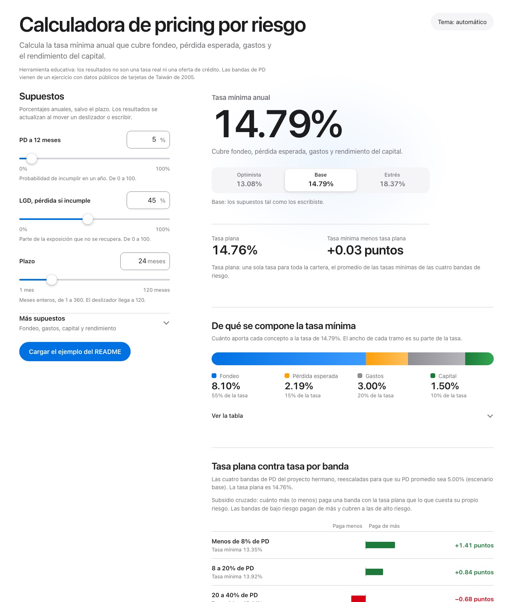
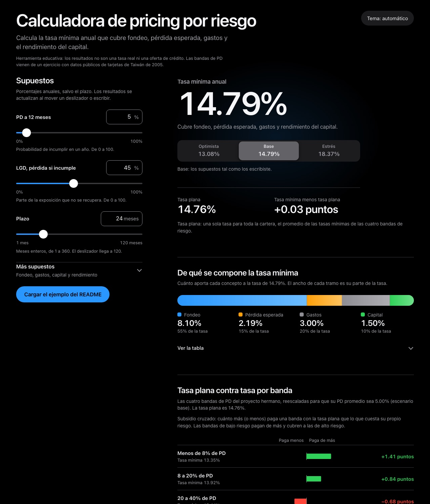
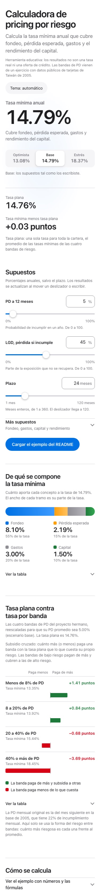
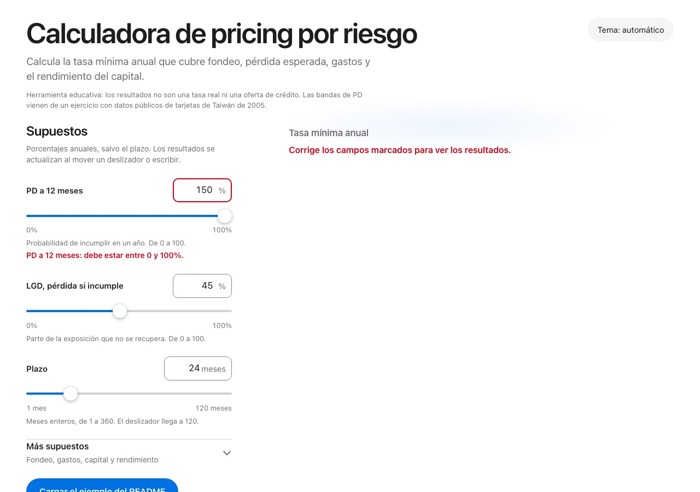

# Calculadora de pricing por riesgo

Página estática que calcula la tasa anual mínima que cubre el riesgo de un crédito, compara una tasa plana con una tasa por banda de PD y estima el subsidio cruzado entre bandas. Incluye gráficas SVG y tres escenarios.

Es una herramienta educativa. Sus resultados no constituyen una tasa real, una oferta ni una recomendación de crédito. Usa solo datos públicos y no incluye información de ningún banco.



## Cómo usarla

```bash
python -m http.server 8000 --bind 127.0.0.1 --directory web
```

Abre http://127.0.0.1:8000. También funciona abriendo `web/index.html` directo, porque no lee archivos externos. Cada supuesto se captura en un campo numérico y en un deslizador sincronizado (el del plazo llega a 120 meses y el campo acepta hasta 360). Un selector de escenario cambia toda la vista entre optimista, base y estrés. La tabla por banda queda plegada bajo «Ver la tabla». Los supuestos principales son la PD a 12 meses, la LGD y el plazo en meses. El costo de fondeo, los gastos operativos, el capital asignado y el rendimiento exigido al capital están en una sección aparte de supuestos adicionales. La página muestra la tasa mínima y la compara con la tasa plana; las fórmulas se pueden desplegar, con un ejemplo numérico. Hay tema claro, oscuro o automático. El botón de ejemplo carga los valores de la sección siguiente.

## Fórmulas

Se supone un crédito de pago único al vencimiento, con exposición constante y una tasa de incumplimiento constante en el tiempo. Sea T el plazo entre 12.

```text
PD acumulada          = 1 - (1 - PD)^T
pérdida esperada anual = LGD x PD acumulada / T
fondeo                = costo de fondeo x (1 - capital asignado)
capital               = capital asignado x rendimiento exigido
tasa mínima           = fondeo + pérdida esperada anual + gastos operativos + capital
```

El capital asignado es la parte de la exposición que se financia con capital propio. Esa parte no paga fondeo y exige el rendimiento que se le pida. A 12 meses la pérdida esperada es PD por LGD. Con plazos mayores la PD acumulada crece menos que proporcionalmente, así que la pérdida anualizada baja un poco.

### Tasa plana, tasa por banda y subsidio cruzado

Las cuatro bandas de PD vienen de riesgo-credito-politicas (`resultados/precio_riesgo.csv`): menos de 8%, 8 a 20%, 20 a 40% y 40% o más, con 306, 5,961, 1,541 y 1,192 clientes en la muestra de prueba. Su PD media es 7.4%, 13.1%, 28.7% y 61.3%, y el promedio ponderado es 21.9%. Es una PD de un mes.

Como esas cifras no son anuales, la calculadora toma de ellas solo la forma del riesgo. Cada banda se reescala así:

```text
PD de la banda = PD de entrada x (PD mensual de la banda / 21.94%), con tope de 100%
```

Con eso el promedio ponderado por clientes de las bandas es la PD que escribe la persona. La tasa mínima de cada banda sale de la fórmula anterior con su PD. La tasa plana es el promedio de esas tasas ponderado por clientes, y el subsidio cruzado de una banda es la tasa plana menos su tasa mínima. Un subsidio positivo quiere decir que la banda paga de más y financia a otras; uno negativo, que paga menos de lo que cuesta. La suma ponderada de los subsidios es cero por construcción.

## Ejemplo numérico

Entradas: PD 5%, LGD 45%, fondeo 9%, gastos 3%, capital asignado 10%, rendimiento exigido 15% y plazo de 24 meses, de modo que T = 2.

| Paso | Cuenta | Resultado |
| --- | --- | --- |
| PD acumulada | 1 - 0.95^2 | 9.75% |
| Pérdida esperada anual | 0.45 x 9.75% / 2 | 2.19375% |
| Fondeo | 9% x 0.90 | 8.1% |
| Capital | 10% x 15% | 1.5% |
| Gastos | dato | 3% |
| Tasa mínima | 8.1% + 2.19375% + 3% + 1.5% | 14.79375% |

Por bandas, con la PD reescalada a 5% de promedio:

| Banda | % de clientes | PD reescalada | Tasa mínima | Subsidio |
| --- | --- | --- | --- | --- |
| Menos de 8% | 3.4% | 1.68% | 13.35% | +1.41 puntos |
| 8 a 20% | 66.2% | 2.98% | 13.92% | +0.84 puntos |
| 20 a 40% | 17.1% | 6.54% | 15.44% | -0.68 puntos |
| 40% o más | 13.2% | 13.98% | 18.45% | -3.69 puntos |

La tasa plana sale en 14.76%, un poco debajo de la tasa mínima a la PD media (14.79%). A 24 meses la PD acumulada es cóncava en la PD anual (crece menos que proporcionalmente), y por eso el promedio de las tasas de las bandas queda por debajo de la tasa calculada con el promedio de la PD. Los escenarios del ejemplo dan 13.08% (optimista), 14.79% (base) y 18.37% (estrés).

Estas cifras las verifican las pruebas. Con una tasa plana, las dos bandas de menor riesgo pagan de más y la banda de 40% o más queda 3.69 puntos por debajo de su costo. Es la misma mecánica que mostró riesgo-credito-politicas, con otras magnitudes.

## Pruebas

```bash
node --test tests/formulas.test.js
python -m pytest
```

Las pruebas de Node ejecutan el código de la página (`web/formulas.js`) contra el ejemplo de arriba. Las de Python reescriben la fórmula por separado, verifican el mismo ejemplo y, si hay Node, comparan ambos lenguajes en 200 casos al azar. También hay una prueba que compara las bandas con el CSV de riesgo-credito-politicas cuando está en la carpeta vecina, y otra que revisa la política CSP y la ausencia de innerHTML, eval y recursos externos.

## Seguridad y accesibilidad

La política CSP del HTML permite solo recursos del mismo origen y la página no usa dependencias ni fuentes externas. Los textos entran al DOM con textContent. Cada campo tiene etiqueta, rango y mensaje de error, y se rechazan valores vacíos, fuera de rango o con decimales en el plazo. Los colores cumplen contraste AA en tema claro y oscuro, el teclado llega a todo y el foco se ve. Revisé la página en 375 px de ancho.



En 375 px de ancho: 

Con un dato fuera de rango no se calcula y se marca el campo: 

## Límites

- El modelo supone un crédito de pago único con exposición constante; no representa un crédito que amortiza ni una tarjeta revolvente.
- La PD y la LGD son datos de entrada. La calculadora no las estima.
- La forma del riesgo entre bandas viene de una base de tarjetas de Taiwán de 2005, con una tasa de incumplimiento muy alta.
- Los escenarios usan factores fijos de ejemplo.
- No incluye impuestos, comisiones, prepagos, recuperaciones diferidas ni el costo de la liquidez.

## Referencia

Yeh, I. C. y Lien, C. H. (2009). The comparisons of data mining techniques for the predictive accuracy of probability of default of credit card clients. Expert Systems with Applications, 36(2).

Licencia MIT.
